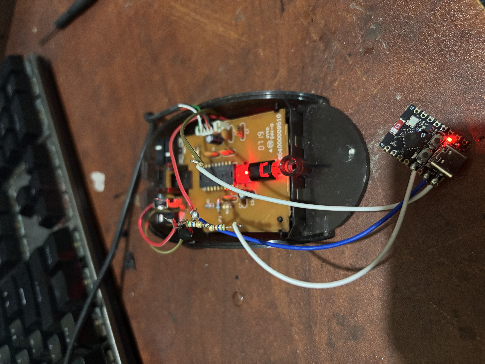
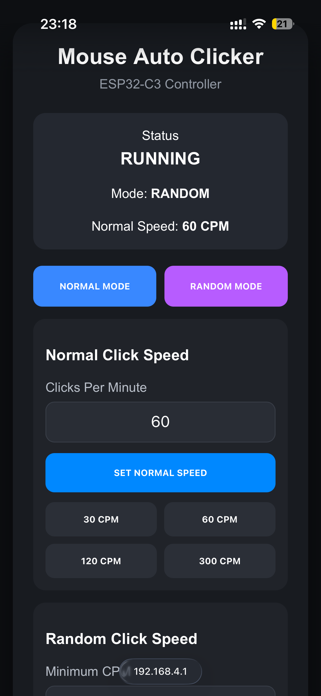

# ESP32-C3 Mouse Auto Clicker

I modified an existing mouse with an ESP32-C3 and a 2N2222 transistor, then made a Wi-Fi web interface using Arduino IDE firmware. This repository documents that project with the supplied hardware photo and phone screenshot.

**Source status:** the original Arduino sketch has not yet been recovered. Code added here is a new reference implementation, not the original device firmware. Exact GPIO, component values, build date and physical test results remain unconfirmed.



## Original web interface



The supplied screen shows normal/random modes, RUNNING status, a CPM input, and 30/60/120/300 CPM presets. It belongs to the earlier project; the new reference dashboard is a separate implementation. No demo video was supplied.

## Reference firmware

The sketch uses the ESP32-C3 as a Wi-Fi controller for a transistor interface across a compatible mouse button circuit. The existing mouse electronics generate the actual mouse events.

- Normal timing and configurable random CPM bounds.
- Browser Start, Stop and status controls served locally without cloud services.
- Strict 1–600 CPM input validation; settings changes stop the run.
- Nominal 25 ms pulses, stopped on boot and a five-minute maximum run.
- Simulation enabled by default, with no output GPIO selected.

These are new reference implementation features, not claims about the original sketch. The exact switching circuit and GPIO must be verified before enabling output. The host-side pulse count records commands, not confirmed computer clicks.

## Build and use

Follow [Arduino IDE setup](docs/SETUP.md). Copy `config.example.h` to a local `config.h`, set your own AP password, and begin in simulation mode. Check [hardware](docs/HARDWARE.md) and [conditional transistor wiring guidance](docs/WIRING.md) before connecting the mouse interface.

The original pin assignment and resistor values are unknown. This repository does not provide a verified circuit schematic or recovered original firmware. If I recover those files, they can be added separately with their source history intact.

## Validation

See [testing and pending checks](docs/TESTING.md). Portable C++ tests cover input rejection, timing, stopping, random bounds and clock rollover. The complete reference sketch also compiled for the generic ESP32-C3 target with Arduino-ESP32 3.3.10 in simulation configuration. Physical click rate, circuit compatibility and long-term reliability have not been measured here.

```sh
mkdir -p build
g++ -std=c++17 -Wall -Wextra -Werror -pedantic tests/test_settings.cpp -o build/test_settings
g++ -std=c++17 -Wall -Wextra -Werror -pedantic tests/test_engine.cpp -o build/test_engine
build/test_settings
build/test_engine
```

## Files and history

| Folder | Contents |
| --- | --- |
| `firmware/MouseAutoClicker/` | New Arduino reference sketch, local dashboard and timing logic |
| `media/` | Supplied photo and screenshot with embedded metadata removed |
| `docs/` | Evidence, hardware, setup, API and validation notes |
| `tests/` | Portable behavior tests |

[Source provenance](docs/PROVENANCE.md) · [Observed original interface](docs/OBSERVED_INTERFACE.md) · [Reference API](docs/API.md)

The publication history contains 20 focused commits created while assembling this repository. These document current publication work, not a recovered or backdated development timeline.

Project by [Dileepa Nayanajith](https://github.com/DileepaNayanajith).
